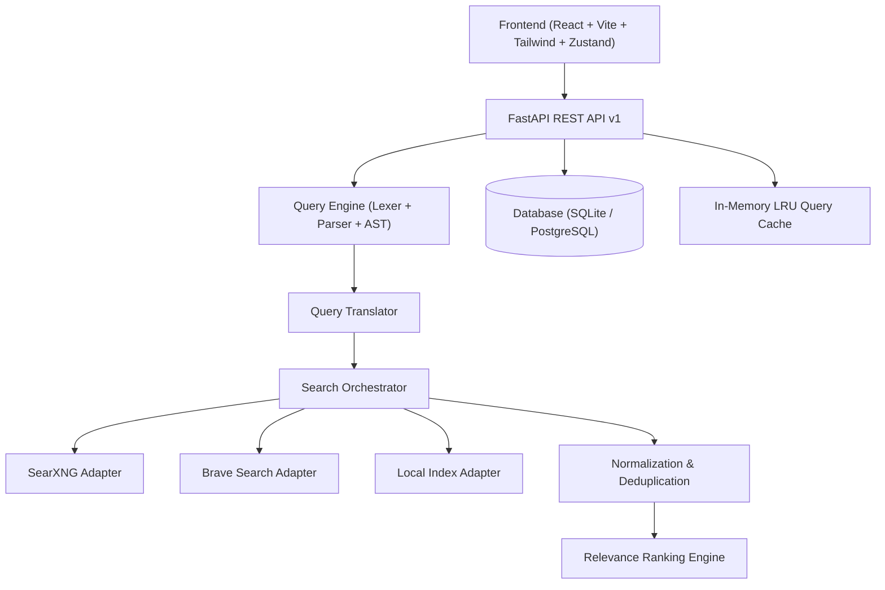

# Dork Atlas Ultimate — Architecture Specification

## 1. System Overview

Dork Atlas Ultimate is engineered as a decoupled, multi-tier search engine and research platform.

---

## 2. Frontend Architecture

- **Framework**: React 18 with TypeScript and Vite.
- **Styling**: Tailwind CSS tailored to the dark theme (`#0f0f10` background, `#19191b` panels, `#b8f352` lime-green accent, Inter & JetBrains Mono typography).
- **State Management**: Zustand store with persistence middleware and zero-loss legacy data migration handlers for `dork-atlas-favorites-v1`, `dork-atlas-custom-v1`, and `dork-atlas-recent-v1`.
- **Search Interaction**: Asynchronous in-app search via `AtlasResults` component with live query preview, pagination, provider status reporting, and safe fallback to Google search.

---

## 3. Backend Architecture

- **Framework**: FastAPI (Python 3.11+) with async routes and lifespan context.
- **ORM / Database**: SQLAlchemy 2.0 with async engine support (`aiosqlite` for local development, `asyncpg` for PostgreSQL in production).
- **Validation**: Pydantic v2 request and response contracts enforcing input length bounds, typing, and sanitization.
- **Middleware**:
  - `SecurityHeadersMiddleware`: Enforces `X-Content-Type-Options: nosniff`, `X-Frame-Options: DENY`, `Referrer-Policy: strict-origin-when-cross-origin`.
  - `RequestSizeLimitMiddleware`: Rejects request payloads exceeding 512 KB.
  - `RateLimitMiddleware`: Token-bucket IP rate limiter.

---

## 4. Query Engine & AST

Instead of string concatenation, Dork Atlas Ultimate processes search queries into an Abstract Syntax Tree (AST):

- **Lexer** (`app.search.parser.lexer`): Tokenizes raw dork queries into typed tokens (`WORD`, `PHRASE`, `LPAREN`, `RPAREN`, `OR`, `AROUND`), handling prefix operators (`site:`, `filetype:`, `intitle:`, `inurl:`, `intext:`, `before:`, `after:`, `related:`) and negation prefixes (`-`).
- **Parser** (`app.search.parser.parser`): Recursive-descent parser producing `QueryAST` with nodes: `Keyword`, `Phrase`, `Operator`, `Exclude`, `Group`, `OrGroup`, `AroundClause`.
- **Diagnostics**: Tracks non-fatal warnings (e.g. unclosed parentheses, dangling ORs) alongside fatal syntax errors.
- **Translator** (`app.search.parser.translator`): Maps AST nodes into provider-compatible query formats. Unsupported operators are dropped with recorded warnings and transferred to local post-filters when applicable.

---

## 5. Multi-Engine Search Orchestration

The orchestrator (`app.search.orchestrator.engine`):
1. Accepts internal `SearchRequest`.
2. Translates the AST concurrently across selected provider adapters.
3. Dispatches bounded concurrent requests using `asyncio.gather` and semaphores.
4. Collects responses, isolating errors so a failure in one provider does not fail the entire search.
5. Normalizes URLs (stripping UTM tracking parameters, extracting canonical domains).
6. Deduplicates across providers while preserving provenance.
7. Executes local post-filters for constraints unsupported natively by a provider.
8. Computes explainable relevance scores based on title matches, term frequency, and freshness.
9. Persists execution history and records provider latencies.

---

## 6. Database Schema

- `query_presets`: Builtin (56 items) and user-created custom presets with category, query template, slug, and scope.
- `preset_favorites`: Bookmarked preset relationships.
- `search_history`: Search query logs with parsed operators, provider statuses, duration, result count, and pin flag.
- `provider_configs`: Configured search provider instances with endpoints, priorities, rate limits, and health states.
- `legacy_imports`: SHA-256 payload tracking preventing duplicate legacy imports.
- `app_settings`: Persistent workspace and system configuration.
